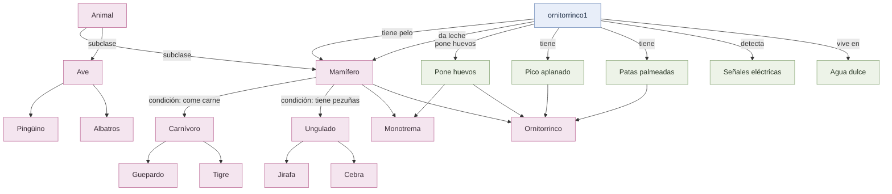

# Ontología del dominio: identificación de animales

## 1. Propósito

Este documento representa el conocimiento formalizado en la actividad de adquisición de conocimiento. El dominio es la **identificación y clasificación de animales**. Se incluyen las clases generales de la bióloga y los hechos y reglas añadidos para identificar al ornitorrinco.

## 2. Clases principales

- **Animal:** concepto general.
- **Mamífero:** animal que cumple al menos una de las condiciones de clasificación establecidas: tener pelo o dar leche a sus crías.
- **Ave:** animal que tiene plumas, o que vuela y pone huevos, según las reglas originales.
- **Carnívoro:** mamífero que come carne.
- **Ungulado:** mamífero que tiene pezuñas.
- **Especies identificadas:** guepardo, tigre, jirafa, cebra, pingüino, albatros y ornitorrinco.
- **Monotrema:** clasificación derivada para un mamífero que pone huevos, de acuerdo con la regla agregada en la actividad.

## 3. Individuo y hechos registrados

El individuo concreto utilizado para probar las reglas es `ornitorrinco1`.

| Predicado | Interpretación |
|---|---|
| `tiene_pelo(ornitorrinco1)` | Tiene pelo. |
| `da_leche(ornitorrinco1)` | Produce leche para alimentar a sus crías. |
| `pone_huevos(ornitorrinco1)` | Pone huevos. |
| `pico_aplanado(ornitorrinco1)` | Tiene pico aplanado. |
| `patas_palmeadas(ornitorrinco1)` | Tiene patas palmeadas. |
| `detecta_senales_electricas(ornitorrinco1)` | Detecta señales eléctricas bajo el agua. |
| `nada(ornitorrinco1)` | Nada. |
| `vive_agua_dulce(ornitorrinco1)` | Vive en ambientes de agua dulce. |

## 4. Relaciones principales

Las relaciones se representan como tuplas `(sujeto, relación, objeto)`:

- `(ornitorrinco1, es_un, animal)`
- `(ornitorrinco1, tiene_caracteristica, pico_aplanado)`
- `(ornitorrinco1, tiene_caracteristica, patas_palmeadas)`
- `(ornitorrinco1, tiene_caracteristica, pelaje)`
- `(ornitorrinco1, tiene_habitat, agua_dulce)`
- `(ornitorrinco1, presenta_capacidad, electrorrecepcion)`

## 5. Reglas de inferencia

Las reglas principales transcritas de la actividad son:

1. Si tiene pelo **o** da leche, entonces es mamífero.
2. Si tiene plumas **o** vuela y pone huevos, entonces es ave.
3. Si es mamífero y come carne, entonces es carnívoro.
4. Si es mamífero y tiene pezuñas, entonces es ungulado.
5. Si cumple las características indicadas, puede identificarse como guepardo, tigre, jirafa, cebra, pingüino o albatros.
6. Si es mamífero, pone huevos, tiene pico aplanado y patas palmeadas, entonces es ornitorrinco.
7. Si es ornitorrinco y detecta señales eléctricas, entonces presenta electrorrecepción.
8. Si es mamífero y pone huevos, entonces es monotremo.
9. Si es mamífero, tiene pico aplanado y pone huevos, se puede distinguir de mamíferos acuáticos como la nutria y el castor, según el criterio de la actividad.

## 6. Gráfica de la ontología

El siguiente diagrama utiliza Mermaid. En VS Code puede visualizarse con una extensión compatible con Mermaid o desde un visor Markdown que soporte diagramas.

## 7. Interpretación del razonamiento

A partir de los hechos de `ornitorrinco1`, el sistema puede inferir:

- Es mamífero porque tiene pelo y produce leche.
- Es ornitorrinco porque es mamífero, pone huevos, tiene pico aplanado y patas palmeadas.
- Es monotremo porque es mamífero y pone huevos.
- Presenta electrorrecepción porque se registró que detecta señales eléctricas.
- No se clasifica como ave con las reglas originales, porque no se registró que tenga plumas ni que vuele.

**Importante:** poner huevos por sí solo no permite concluir que sea un ave. La regla original exige plumas o la combinación de volar y poner huevos.

## 8. Alcance y consideraciones

Esta ontología representa la información contenida en la actividad y las reglas propuestas en la entrevista. No se agregan hechos para nutria o castor, por lo que la regla de diferenciación expresa el criterio para distinguir al ornitorrinco, pero no construye una clasificación completa de esas otras especies.

La implementación en Python utiliza diccionarios para almacenar los hechos y reglas, y tuplas para representar relaciones. El programa aplica encadenamiento hacia adelante para obtener conclusiones a partir de los hechos disponibles.
